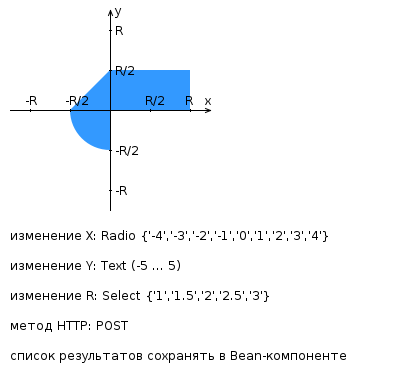

# My option: 45699

[Link to frontend-only](https://se.ifmo.ru/~s502362/3/index.html)

# Лабораторная работа #3

Разработать веб-приложение на базе сервлетов и JSP, определяющее попадание точки на координатной плоскости в заданную область.

Приложение должно быть реализовано в соответствии с шаблоном MVC и состоять из следующих элементов:

- **ControllerServlet**, определяющий тип запроса и, в зависимости от того, содержит ли запрос информацию о координатах точки и радиусе, делегирующий его обработку одному из перечисленных ниже компонентов. Все запросы внутри приложения должны передаваться этому сервлету (по методу POST в зависимости от варианта задания), остальные сервлеты с веб-страниц напрямую вызываться не должны.
- **AreaCheckServlet**, осуществляющий проверку попадания точки в область на координатной плоскости и формирующий HTML-страницу с результатами проверки. Должен обрабатывать все запросы, содержащие сведения о координатах точки и радиусе области.
- **Страница JSP**, формирующая HTML-страницу с веб-формой. Должна обрабатывать все запросы, не содержащие сведений о координатах точки и радиусе области.

**Разработанная страница JSP должна содержать**:

- «Шапку», содержащую ФИО студента, номер группы и номер варианта.
  Форму, отправляющую данные на сервер.
- Набор полей для задания координат точки и радиуса области в соответствии с вариантом задания: Radio {'-4','-3','-2','-1','0','1','2','3','4'} для координаты по оси X, Text (-5 ... 5) для координаты по оси Y, Select {'1','1.5','2','2.5','3'} для задания радиуса области.
- Сценарий на языке JavaScript, осуществляющий валидацию значений, вводимых пользователем в поля формы.
- Интерактивный элемент, содержащий изображение области на координатной плоскости (в соответствии с вариантом задания) и реализующий следующую функциональность: если радиус области установлен, клик курсором мыши по изображению должен обрабатываться JavaScript-функцией, определяющей координаты точки и отправляющей их на сервер для проверки; в противном случае после клика должно выводиться сообщение о невозможности определения координат. После проверки изображение должно обновляться с учётом результатов.
- Таблицу с результатами предыдущих проверок. Список результатов должен браться из Bean-компоненте.

**Страница, возвращаемая AreaCheckServlet, должна содержать**:

- Таблицу, содержащую полученные параметры.
- Результат вычислений — факт попадания или непопадания точки в область.
- Ссылку на страницу с веб-формой для формирования нового запроса.

Разработанное веб-приложение необходимо развернуть на сервере WildFly. Сервер должен быть запущен в standalone-конфигурации, порты должны быть настроены в соответствии с выданным portbase, доступ к http listener'у должен быть открыт для всех IP.

---

**Вопросы к защите лабораторной работы**:

1. Java-сервлеты. Особенности реализации, ключевые методы, преимущества и недостатки относительно CGI и FastCGI.
1. Контейнеры сервлетов. Жизненный цикл сервлета.
1. Диспетчеризация запросов в сервлетах. Фильтры сервлетов.
1. HTTP-сессии - назначение, взаимодействие сервлетов с сессией, способы передачи идентификатора сессии.
1. Контекст сервлета - назначение, способы взаимодействия сервлетов с контекстом.
1. JavaServer Pages. Особенности, преимущества и недостатки по сравнению с сервлетами, область применения.
1. Жизненный цикл JSP.
1. Структура JSP-страницы. Комментарии, директивы, объявления, скриптлеты и выражения.
1. Правила записи Java-кода внутри JSP. Стандартные переменные, доступные в скриптлетах и выражениях.
1. Bean-компоненты и их использование в JSP.
1. Стандартные теги JSP. Использование Expression Language (EL) в JSP.
1. Параметры конфигурации JSP в дескрипторе развёртывания веб-приложения.
1. Шаблоны проектирования и архитектурные шаблоны. Использование в веб-приложениях.
1. Архитектура веб-приложений. Шаблон MVC. Архитектурные модели Model 1 и Model 2 и их реализация на платформе Java EE.
